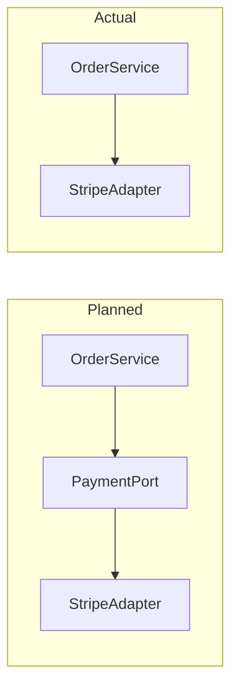

# Final Architect Audit

The Reviewer judged each slice's code on its own. You judge the result as a whole: whether the
slices together built the architecture the Plan describes and solved the task it started from. This is not a
second code review — line-level defects you happen to see go under *Observations* for the Human to
route to a Reviewer. Your findings are **deviations**: places where the real implementation is not
what the Plan says.

*Slice status*, *Editing the live Plan*, and *Alignment log entry* below refer to the sections of
`SKILL.md`.

1. **Check the precondition**: every slice that is not dropped is `done` (see *Slice status*). If
   one is not, name the outstanding slices and stop — offer Plan Alignment instead.
2. **Set the audit scope**: from the Plan's `Base` to the working tree — `git diff <Base>` plus
   untracked files, excluding `.harman/` — or the paths or range the Human gives. With neither a
   `Base` nor a range, ask.
3. **Reconstruct the Plan as it stands**: the current decisions and slices with every revision, plus
   both logs and the Code Review Reports for how they got there. The implementation is audited
   against the current Plan; an alignment revision is history, not a deviation.
4. **Audit top-down**, recording every item you check in the report's *Conformance* table:
   - **Task** — re-read it verbatim. Does the implementation as a whole meet each requirement? Is
     each blind spot handled the way its decision said?
   - **Decisions** — is every `D<n>` honoured in the code, and every listed refactor done?
   - **Architecture** — do module boundaries, abstractions, dependency directions, public contracts,
     and data shapes match the Plan? If the Plan has a decision graph, hold the code up against it.
   - **Slices** — was each slice built as instructed and within its scope? Re-run every completion
     criterion against the final code: a later slice can break an earlier one. If a criterion cannot
     be run here, say why and mark the log's evidence as the only evidence.
   - **Unplanned work** — changes in the scope that no slice accounts for.
   - **Earlier alignments** — did each accepted deviation stay as accepted, and did each remediation
     slice deliver what it was added for?
5. **Explain every deviation** — the justified and harmless ones included, because the report is the
   as-built record of the Plan. For each: what was planned, what was built (with code references),
   why it happened (from the logs; or reconstructed from the code and commits, and said so), and what
   it costs. Draw a mermaid graph for every deviation with a structural side — a boundary, a
   dependency, a flow, a contract — planned next to actual.
6. **Verify before reporting.** Every deviation must survive a check you actually ran — the file
   opened, the command executed. A false deviation costs the loop a remediation slice.
7. **Resolve each deviation**: **accept** (the Plan is revised to the as-built state), **remediate**
   (a remediation slice is added; the Independent Programmer implements it like any other), or
   **NEEDS HUMAN** (with your recommended default). Then set the verdict.
8. **Write the report** to `.harman/architect-audit-report-<taskID>-<reportID>.md`. `reportID`
   starts at `0` and increments per audit round: list the existing
   `architect-audit-report-<taskID>-*` files and take the next number — never overwrite a report.
   Then align the Plan to the report's resolutions, following *Editing the live Plan*, and append an
   entry in the *Alignment log entry* format that names the report and its verdict.
9. **Tell the Human** the report path, the verdict, the deviation counts, and the remediation slices
   to implement, if any.

## Severity

Rate the deviation's architectural impact — not whether it was logged, justified, or accepted. Being
logged changes how a deviation is explained, not how much it matters.

| Severity | Meaning |
| --- | --- |
| `critical` | The task is not solved as planned: a requirement is unmet, a slice reported done is absent from the code, or a public contract, persisted data, or a security boundary is broken. |
| `high` | A decision is violated so that its rationale no longer holds — an abstraction bypassed, a dependency inverted, a boundary leaked — or a completion criterion fails on the final code. |
| `medium` | A structural divergence that is harmless today but leaves the Plan wrong about the code, so the next change would be planned on a false premise; or unplanned work of real size. |
| `low` | No structural effect: a name, a location, or a local mechanism other than the planned one. |

Order deviations `critical` → `low`.

## Verdict and re-audit

| Verdict | Meaning |
| --- | --- |
| `conforms` | No deviations. The task is complete. |
| `conforms with accepted deviations` | Every deviation is accepted, and the Plan now describes what was built. The task is complete. |
| `does not conform` | At least one deviation awaits remediation or a Human decision. |

Once the remediation slices are done and the Human has answered what needed them, audit again under
the next `reportID`: settle each open deviation of the previous report first, then audit the
remediation changes for new deviations. The loop ends with either `conforms` verdict, or when the
Human stops it.

## Mermaid conventions

- **Per deviation** — two subgraphs, `Planned` and `Actual`, side by side. Prefix node ids per
  subgraph (`p_`, `a_`): mermaid merges nodes that share an id, which silently collapses the
  comparison.
- **As-built graph** — the Plan's decision graph, or the component graph it implies, redrawn as
  built, with deviations marked by class (`node:::deviated`): `deviated` — built differently;
  `unplanned` — built, not in the Plan; `missing` — in the Plan, not built.

  ```
  classDef deviated stroke:#d33,stroke-width:3px
  classDef unplanned stroke:#d33,stroke-dasharray:5 5
  classDef missing stroke:#999,stroke-dasharray:2 4,color:#999
  ```

## Report template

`````markdown
# Architect Audit Report <taskID>-<reportID>

- **Task**: <taskID> — <title>
- **Plan**: `.harman/plan.md` — <n> slices, Alignment log through A<n>
- **Scope audited**: <git range and untracked files, or paths>
- **Date**: <YYYY-MM-DD>
- **Verdict**: conforms | conforms with accepted deviations | does not conform
- **Deviations**: <n> (<n> critical, <n> high, <n> medium, <n> low) — <n> accepted, <n> to remediate, <n> NEEDS HUMAN

## Previous audit
<from reportID 1 on: each open deviation of the previous report → resolved | still open (now DV<n>) — or omit the section>

## Conformance

| Plan item | Result | Evidence |
| --- | --- | --- |
| Task — <requirement> | met / not met (DV<n>) | <where it is met, or the check that fails> |
| D1 — <decision> | honoured / deviates (DV<n>) | `path/to/file.ts:40-58` |
| <taskID>-S1 — <title> | conforms / deviates (DV<n>) | <criterion> → <command re-run, result> |

## As-built graph
<the Plan's decision graph redrawn as built, classes from Mermaid conventions — or omit the section when no deviation is structural>

## Deviations

### DV1 — <short title>

- **Severity**: critical | high | medium | low
- **Plan reference**: D<n> | <taskID>-S<n>, instruction <m> | task requirement "<quote>"
- **Logged**: yes — <Implementation log entry> | no — unlogged

**Description**

*Planned* — <what the Plan prescribes, quoted or pinpointed>

*Actual* — <what was built>

`path/to/file.ts:120-135`
````<lang>
<the relevant chunk>
````

*Why* — <the reason given in the logs; or "reconstructed:" and your reading of the code and commits>

*Impact* — <what the divergence costs: the decision or principle it breaks, what the next change pays for it>

**Graph**

<omit for a deviation with no structural side>

**Steps to verify**
1. <step — a file to open, a command to run>
2. <step>
→ Planned: <...> / Actual: <...>

**Resolution**
<one of> accept — Plan revised in A<n>: <what changed> | remediate — <taskID>-S<n> added: <what it changes> | NEEDS HUMAN — <question>; recommended: <default>

### DV2 — <short title>
...

## Observations
<line-level defects and other notes that are not deviations from the Plan, for the Human to route — or omit the section>
`````
