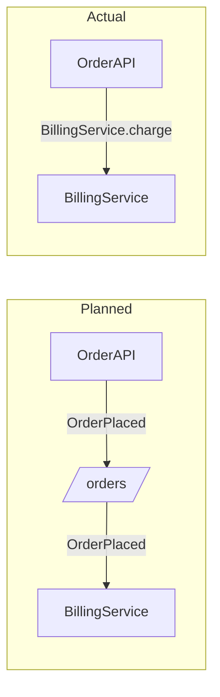

# Final Architect Audit

The Reviewer judged each slice's code on its own. You judge the result as a whole: whether the slices together built the architecture the Plan describes and solved the Task it started from.
- This is not a second code review: line-level defects you happen to see go under *Observations*, for the Human to route to a Reviewer.
- Your findings are **Deviations**: places where the real implementation is not what the Plan says.

The shared sections of `SKILL.md` apply to the report and to every change you make to the Plan.

1. **Check the precondition**:
   - every slice that is not dropped is `done` (see *Slice status*); if one is not:
     1. name the outstanding slices;
     2. stop;
     3. offer Plan Alignment instead;
   - every done slice's code is in the checkout you audit:
     - for a slice built in another worktree — its log ends on a commit with no uncommitted changes, and that commit is an ancestor of `HEAD` (`git merge-base --is-ancestor <sha> HEAD`);
     - if a done slice is not merged here, or you cannot tell — name it and stop: the Human integrates it first.
2. **Set the audit scope**:
   - from the Plan's `Base` to the working tree — `git diff <Base>` plus untracked files, excluding `.harman/`;
   - or the paths or range the Human gives;
   - with neither a `Base` nor a range, ask.
3. **Reconstruct the Plan as it stands**:
   - the current Decisions and slices, with every revision — in `plan.md` and in the Detailed documents;
   - for how they got there:
     - the Alignment log;
     - the Implementation logs;
     - the Code Review Reports;
   - the implementation is audited against the current Plan: an alignment revision is history, not a Deviation.
4. **Audit top-down**, recording every item you check in the report's *Conformance* table:
   - **Task** — re-read it verbatim. Does the implementation as a whole meet each requirement? Is each Blind spot handled the way its Decision said?
   - **Decisions** — is every Decision honoured in the code, Refactors included?
   - **Architecture** — do these match the Plan's diagrams — the Architecture diagram in `plan.md` and each Decision's diagrams?
     - module boundaries;
     - abstractions;
     - dependency directions;
     - public contracts;
     - data shapes.
   - **Slices** — was each slice built as instructed and within its scope?
     - re-run every Completion criterion against the final code: a later slice can break an earlier one;
     - if a criterion cannot be run here, say why and mark the log's evidence as the only evidence.
   - **Unplanned work** — changes in the scope that no slice accounts for.
   - **Earlier alignments** — did each accepted Deviation stay as accepted, and did each remediation slice deliver what it was added for?
5. **Explain every Deviation** — the justified and harmless ones included, because the report is the as-built record of the Plan:
   - what was planned;
   - what was built, with code references;
   - why it happened — from the logs; or reconstructed from the code and commits, and said so;
   - what it costs;
   - for every Deviation with a structural side — a boundary, a dependency, a flow, a contract — a mermaid graph, planned next to actual.
6. **Verify before reporting.** Every Deviation must survive a check you actually ran — the file opened, the command executed. A false Deviation costs the loop a remediation slice.
7. **Resolve each Deviation**, then set the Verdict:
   - **accept** — the Plan is revised to the as-built state;
   - **remediate** — a remediation slice is added; the Independent Programmer implements it like any other;
   - **NEEDS HUMAN** — the Human defers the question or can't be asked; give your recommended default.

   A Decision you add or revise follows *Decision making*.
8. **Write the report** to `$HARMAN_DIR/<taskID>/architect-audit-report-<taskID>-<reportID>.md`:
   - `reportID` starts at `0` and increments per audit round: list the existing `architect-audit-report-<taskID>-*` files and take the next number — never overwrite a report;
   - then, in order:
     1. align the Plan to the report's resolutions, following *Editing the live Plan*;
     2. validate the Plan when it changed (see *Validation*);
     3. append an entry in the *Alignment log entry* format that names the report and its Verdict.
9. **Tell the Human**:
   - the report path;
   - the Verdict;
   - the Deviation counts;
   - the remediation slices to implement, if any.

## Severity

Rate the Deviation's architectural impact, not whether it was:
- logged;
- justified;
- accepted.

Being logged changes how a Deviation is explained, not how much it matters.

| Severity | Meaning |
| --- | --- |
| `critical` | The Task is not solved as planned; any of:<br>• a requirement is unmet<br>• a slice reported done is absent from the code<br>• a public contract, persisted data, or a security boundary is broken |
| `high` | Any of:<br>• a Decision is violated so that its rationale no longer holds — an abstraction bypassed, a dependency inverted, a boundary leaked<br>• a Completion criterion fails on the final code |
| `medium` | Any of:<br>• a structural divergence, harmless today, that leaves the Plan wrong about the code, so the next change would be planned on a false premise<br>• unplanned work of real size |
| `low` | No structural effect; one of these differs from the planned one:<br>• a name<br>• a location<br>• a local mechanism |

- Order Deviations `critical` → `low`.

## Verdict and re-audit

| Verdict | Meaning |
| --- | --- |
| `conforms` | No Deviations. The Task is complete. |
| `conforms with accepted deviations` | Every Deviation is accepted, and the Plan now describes what was built. The Task is complete. |
| `does not conform` | At least one Deviation awaits remediation or the Human's answer. |

- Once the remediation slices are done and the Human has answered what needed them, audit again under the next `reportID`:
  1. settle each open Deviation of the previous report first;
  2. then audit the remediation changes for new Deviations.
- The loop ends with either conforming Verdict — `conforms`, or `conforms with accepted deviations` — or when the Human stops it.

## Mermaid conventions

- **Per Deviation** — the planned structure next to the actual one, each in the diagram its content calls for (see *Diagrams*):
  - components — one `flowchart` with two subgraphs, `Planned` and `Actual`, side by side. Prefix node ids per subgraph (`p_`, `a_`): mermaid merges nodes that share an id, which silently collapses the comparison;
  - a flow — two sequence diagrams, Planned then Actual;
  - a contract, a code-level dependency, or a data shape — two class or ER diagrams, Planned then Actual.
- **As-built graph** — the Plan's Architecture diagram redrawn as built (for a Plan without one, the component graph its Decisions imply), with Deviations marked by class instead of the Plan's change classes (`node:::deviated`):
  - `deviated` — built differently;
  - `unplanned` — built, not in the Plan;
  - `missing` — in the Plan, not built.

  ```
  classDef deviated stroke:#d33,stroke-width:3px
  classDef unplanned stroke:#d33,stroke-dasharray:5 5
  classDef missing stroke:#999,stroke-dasharray:2 4,color:#999
  ```

## Report template

The report follows *Links and Glossary terms* in `SKILL.md`; a link into the Plan starts with `plan/`.

`````markdown
# Architect Audit Report <taskID>-<reportID>

- **Task**: <taskID> — <title>
- **Plan**: [plan/plan.md](plan/plan.md) — <n> slices, Alignment log through A<n>
- **Scope audited**: <git range and untracked files, or paths>
- **Date**: <YYYY-MM-DD>
- **Verdict**: conforms | conforms with accepted deviations | does not conform
- **Deviations**: <n>
  - by severity: <n> critical, <n> high, <n> medium, <n> low;
  - by resolution: <n> accepted, <n> to remediate, <n> NEEDS HUMAN.

## Previous audit
<from reportID 1 on — or omit the section>

| Deviation in the previous report | Now |
| --- | --- |
| DV<n> — <title> | resolved — <how> · still open — now DV<n> |

## Conformance

| Plan item | Result | Evidence |
| --- | --- | --- |
| Task — <requirement> | met / not met (DV<n>) | <where it is met, or the check that fails> |
| [D1 — <title>](plan/decision-1.md) | honoured / deviates (DV<n>) | `path/to/file.ts:40-58` |
| [<taskID>-S1 — <title>](plan/plan.md#<taskID>-S1) | conforms / deviates (DV<n>) | <criterion> → <command re-run, result> |

## As-built graph
<the Plan's Architecture diagram redrawn as built, classes from Mermaid conventions — or omit the section when no Deviation is structural>

## Deviations

### DV1 — <short title>

- **Severity**: critical | high | medium | low
- **Plan reference**: [D<n>](plan/decision-<n>.md) | [<taskID>-S<n>](plan/plan.md#<taskID>-S<n>), instruction <m> | Task requirement "<quote>"
- **Logged**: yes — <Implementation log entry> | no — unlogged

**Description**

| | Planned | Actual |
| --- | --- | --- |
| <aspect: a boundary, a dependency, a contract, a flow, a location> | <what the Plan prescribes, quoted or pinpointed> | <what was built> |

`path/to/file.ts:120-135`
````<lang>
<the relevant chunk>
````

- **Why**: <the reason given in the logs — or "reconstructed:" and your reading of the code and commits>
- **Impact**: <the Decision or principle it breaks; what the next change pays for it>

**Graph**

<omit for a Deviation with no structural side>

**Steps to verify**
1. <step — a file to open, a command to run>
2. <step>
→ Planned: <...> / Actual: <...>

**Resolution**
<one of> accept — Plan revised in A<n>: <what changed> | remediate — [<taskID>-S<n>](plan/plan.md#<taskID>-S<n>) added: <what it changes> | NEEDS HUMAN — <question>; recommended: <default>

### DV2 — <short title>
...

## Observations
<line-level defects and other notes that are not Deviations from the Plan, for the Human to route — or omit the section>
`````
