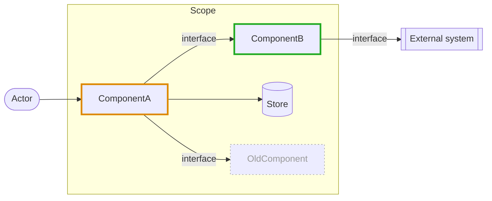
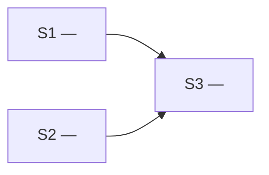
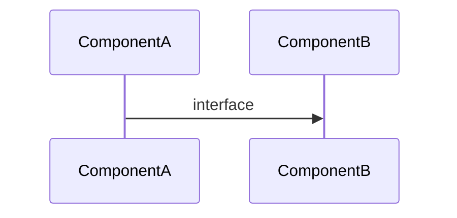
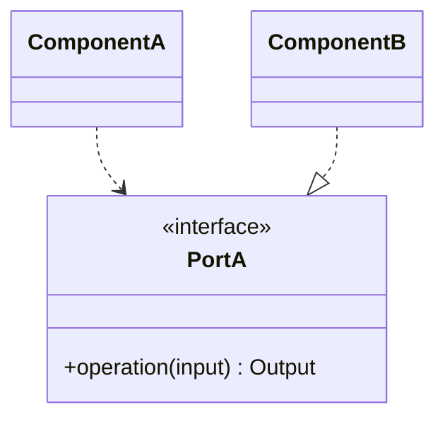

# Plan templates

The Plan's files, in `$HARMAN_DIR/<taskID>/plan/`. The templates show structure and syntax only:
- draw the Task's own diagrams;
- format every link and Glossary term as *Links and Glossary terms* in `SKILL.md` says — the `` [`Order`](glossary.md) `` below shows the form;
- a part with nothing to hold says so — "None." — unless its template says to omit it.

## plan.md

The entry point. Above each slice's heading goes its anchor, `<a id="<taskID>-S<n>"></a>`: links to the slice use it, and it survives a struck title.

````markdown
# Plan: <taskID> — <short title>

- **Base**: <short sha of HEAD when the Plan was written, noting a dirty working tree — or "none" outside git>
- **Implementation logs**: `../log/<taskID>-S<n>.md`, one per slice, written by the Independent Programmer
- **Glossary**:
  - [General Specification](<relative path to it>#glossary) — <omit without a General Specification>
  - [Plan Glossary](glossary.md) — <omit without a Plan Glossary>

## 1. Task
<the Task as given: its words verbatim, its Glossary terms formatted — e.g. "Let customers refund an [`Order`](glossary.md).">

## 2. Blind spots

| ID | Question | Why it matters |
| --- | --- | --- |
| [BS1 — <title>](bs-1.md) | <the question the Task leaves open, as one full sentence> | <what goes wrong while it stays open> |

<or: None — the Task is fully determined.>

## 3. Decisions

| ID | Decision | Closes | Serves | Rationale | Slices | Human approved |
| --- | --- | --- | --- | --- | --- | --- |
| [D1 — <title>](decision-1.md) | <the answer it gives, as one full sentence> | [BS1](bs-1.md) | <principle or pattern> | <one line> | [<taskID>-S1](#<taskID>-S1) | ✓ |
| [D2 — <title>](decision-2.md) | <the refactor, as one full sentence> | refactor | <principle or pattern> | <one line> | [<taskID>-S2](#<taskID>-S2) | |
| [D3 — <title>](decision-3.md) | **NEEDS HUMAN** — <question>; recommended: <default> | [BS2](bs-2.md) | <principle or pattern> | <one line> | [<taskID>-S3](#<taskID>-S3) | |

## 4. The change

### Architecture

<or: No structural change — <why>.>

### Flows
- [D<n> — <title>](decision-<n>.md#flows)

<omit the section when no Decision changes a runtime flow>

### Contracts and data
- [D<n> — <title>](decision-<n>.md#contracts-and-data)

<omit the section when no Decision changes a public contract, a code-level dependency, or a data shape>

## 5. Slices



<a id="<taskID>-S1"></a>
### <taskID>-S1 — <title>
- **Goal**: <one sentence>
- **Depends on**: <[<taskID>-S<n>](#<taskID>-S<n>), … — or "none">
- **Scope**:
  - Touches: <files/modules>
  - Out of scope: <what stays untouched>
- **Instructions**:
  1. <step, concrete enough to need no architectural judgement>
  2. ...
- **Completion criteria**: <checkable condition — or "none — <why>">

<a id="<taskID>-S2"></a>
### <taskID>-S2 — <title>
...

## 6. Alignment log
<!-- Appended by the Architect: one entry per Plan Alignment and per Final Architect Audit. Always the last section. -->
````

## bs-<n>.md

The Detailed document of a Blind spot.

````markdown
# BS<n> — <title>

- **Question**: <what the Task leaves open, as one question>
- **Why it matters**: <what goes wrong while it stays open>
- **Closed by**: [D<n> — <title>](decision-<n>.md)

## Where it shows
- **Task**: "<the Task's words that leave it open>" — <or: not mentioned>
- **Code**:
  - `path/to/file.ts:40-58` — <what there depends on the answer>

<a diagram of what it reaches, when there is one to draw>

## What is unanswered
- <each open point, one per item>

## What depends on it
- <a component, a Decision, or a slice — linked> — <how it depends on the answer>
````

## decision-<n>.md

The Detailed document of a Decision, Refactors included.

`````markdown
# D<n> — <title>

- **Decision**: <what is decided, as one sentence — or: **NEEDS HUMAN** — <question>; recommended: <default>>
- **Closes**: <[BS<n> — <title>](bs-<n>.md) — or: refactor — or, for a Decision added in Plan Alignment, what raised it: `BLOCKED` in [<taskID>-S3](plan.md#<taskID>-S3), [finding F2](../code-review-report-<taskID>-S3-1.md)>
- **Serves**: <principle or pattern>
- **Rationale**: <one line>
- **Slices**: [<taskID>-S<n>](plan.md#<taskID>-S<n>)
- **Human approved**: <✓ — or left empty>

## What it changes
- <component, contract, or file> — <how it changes>

### Flows

#### <the flow>
*Before*

*After*
```mermaid
sequenceDiagram
  ...
```
<omit the section when the Decision changes no runtime flow>

### Contracts and data

#### <the contract or data shape>
*Before* — <a diagram, or "none — new">

*After*

<omit the section when the Decision changes no public contract, code-level dependency, or data shape>

## Existing design
<Refactors only — omit the section otherwise>
- **Design**: `path/to/file.ts:40-58` — <the design that blocks the change>
- **Why it blocks the change**: <one line>

## Alternatives

| Alternative | Why not |
| --- | --- |
| <alternative> | <why it was rejected> |

<or: None.>
`````

## glossary.md

The Plan Glossary, in a General Specification's Glossary format: rows in alphabetical order, each definition one line.

````markdown
# Plan Glossary: <taskID> — <short title>

| Term | Definition |
| --- | --- |
| <Term> | <one-line definition; avoid: <words>, if any> |
````
