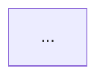
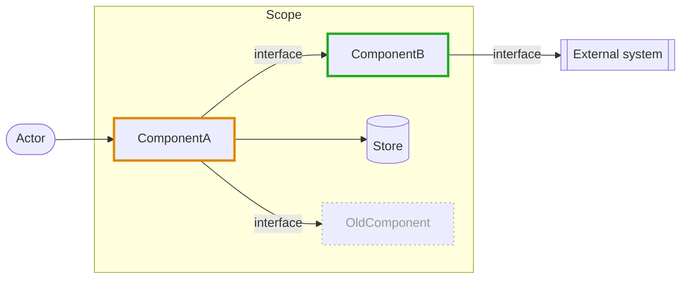
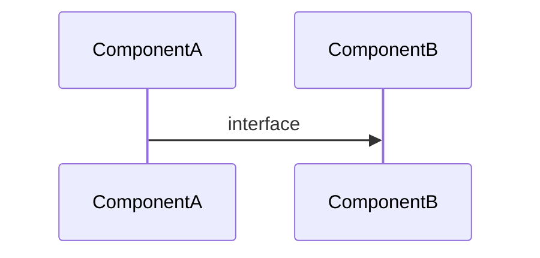
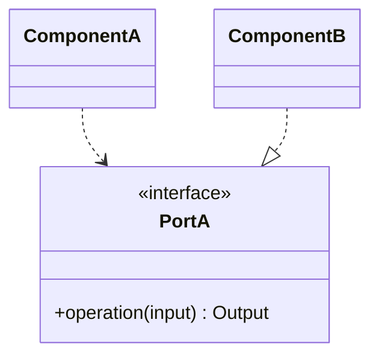
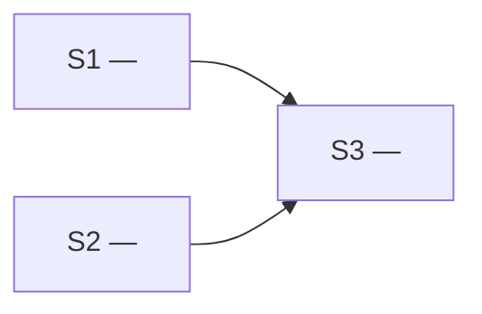

# Planning

Turn the task into `$HARMAN_DIR/<taskID>/plan.md`. The shared sections of `SKILL.md` — artifacts
and ids, *Writing the artifacts*, *Diagrams*, *Operating principles*, *Rules* — apply throughout.

1. **Read the task.** Capture it verbatim in the Plan; do not silently reinterpret it.
2. **Study the code.** Find the modules, seams, and abstractions the change lands in. Identify prior
   architectural decisions that block the change and must be refactored — call them out explicitly
   rather than working around them silently. Record the commit you studied as the Plan's `Base`: the
   Final Architect Audit measures the implementation from it.
3. **List blind spots.** Anything the task leaves unstated: unspecified behaviour, unclear
   ownership, missing acceptance criteria, unhandled edge cases, integration and migration
   questions. If there are none, say so.
4. **Close each blind spot with a decision.** Every blind spot gets a decision and a one-line
   rationale tied to the *Operating principles*. If one genuinely requires the Human (product intent,
   external constraints), mark it **NEEDS HUMAN** and give your recommended default so work is not
   blocked.
5. **Depict the change**:
   - **Architecture** — a component diagram of what the task touches, in its target state, with
     added, changed, and removed parts marked by class (see the template). When the change has no
     structural side, say so in one line instead.
   - **Flows** — for each decision that changes a runtime flow, a sequence diagram before and after.
   - **Contracts and data** — for each decision that changes a public contract, a code-level
     dependency, or a data shape, a class or ER diagram before and after.
   - **Decision graph** — when the decisions interact; skip it for a linear plan.
6. **Slice.** Split the work into the smallest independently completable units, numbered from 1 in
   dependency order. Each slice:
   - touches one concern, and is reviewable on its own;
   - is detailed enough that the implementer makes no architectural decisions — name files, types,
     signatures, and call sites where you already know them;
   - declares its dependencies on other slices;
   - may be built at the same time as any slice it has no dependency path to, each in its own
     worktree — so two such slices must not touch the same file; if they would, make one depend on
     the other;
   - carries a **completion criteria** that is checkable (a passing test, an observable behaviour, a
     command that exits clean). If a slice truly cannot have one, write
     `Completion criteria: none — <why>` rather than inventing a vague one.

   Then draw the slice graph: an arrow from each slice to every slice that depends on it, so the
   build order, and the slices with no path between them — buildable in parallel — show at a glance.
7. **Write the Plan** and tell the Human the path, the slice count, and which slices can be built
   in parallel. A task too small to decompose still gets a single-slice Plan rather than no
   artifact — downstream roles depend on the file existing.

## Plan template

The diagrams show syntax only; draw the task's own.

````markdown
# Plan: <taskID> — <short title>

- **Base**: <short sha of HEAD when the Plan was written, noting a dirty working tree — or "none" outside git>
- **Implementation logs**: `log/<taskID>-S<n>.md` next to this file, one per slice, written by the Independent Programmer

## 1. Task
<the initial task/issue, as given>

## 2. Blind spots

| ID | Blind spot | Why it matters |
| --- | --- | --- |
| BS1 | <what the task leaves unanswered> | <what goes wrong while it stays open> |

<or: None — the task is fully determined.>

## 3. Decisions

| ID | Decision | Closes | Serves | Rationale |
| --- | --- | --- | --- | --- |
| D1 | <decision> | BS1 | <principle or pattern> | <one line> |
| D2 | **NEEDS HUMAN** — <question>; recommended: <default> | BS2 | <principle or pattern> | <one line> |

### Refactors required by prior decisions

| Existing design | Why it blocks the change | Minimum refactor |
| --- | --- | --- |
| `path/to/file.ts:40-58` — <design> | <reason> | <refactor> |

<or: None.>

### Decision graph

<omit when the decisions do not interact>

## 4. The change

### Architecture

<or: No structural change — <why>.>

### Flows

#### D<n> — <the flow>
*Before*

*After*
```mermaid
sequenceDiagram
  ...
```
<omit the section when no decision changes a runtime flow>

### Contracts and data

#### D<n> — <the contract or data shape>
*Before* — <a diagram, or "none — new">

*After*

<omit the section when no decision changes a contract, a code-level dependency, or a data shape>

## 5. Slices



### <taskID>-S1 — <title>
- **Goal**: <one sentence>
- **Depends on**: <slice ids, or "none">
- **Scope**:
  - Touches: <files/modules>
  - Out of scope: <what stays untouched>
- **Instructions**:
  1. <step, concrete enough to need no architectural judgement>
  2. ...
- **Completion criteria**: <checkable condition>

### <taskID>-S2 — <title>
...

## 6. Alignment log
<!-- Appended by the Architect: one entry per Plan Alignment and per Final Architect Audit. Always the last section. -->
````
