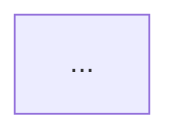

# Planning

Turn the task into `.harman/plan.md`. The shared sections of `SKILL.md` — artifacts and ids,
*Operating principles*, *Rules* — apply throughout.

1. **Read the task.** Capture it verbatim in the Plan; do not silently reinterpret it.
2. **Study the code.** Find the modules, seams, and abstractions the change lands in. Identify prior
   architectural decisions that block the change and must be refactored — call them out explicitly
   rather than working around them silently. Record the commit you studied as the Plan's `Base`: the
   Final Architect Audit measures the implementation from it.
3. **List blind spots.** Anything the task leaves unstated: unspecified behaviour, unclear
   ownership, missing acceptance criteria, unhandled edge cases, integration and migration
   questions. If there are none, say so.
4. **Close each blind spot with a decision.** Every blind spot gets a decision and a one-line
   rationale tied to the *Operating principles*. If one genuinely requires the Human (product intent,
   external constraints), mark it **NEEDS HUMAN** and give your recommended default so work is not
   blocked.
5. **Draw the decision graph** in `mermaid` when the decisions interact or a flow/dependency is
   easier to see than to read. Skip it for a trivially linear plan.
6. **Slice.** Split the work into the smallest independently completable units, numbered from 1 in
   dependency order. Each slice:
   - touches one concern, and is reviewable on its own;
   - is detailed enough that the implementer makes no architectural decisions — name files, types,
     signatures, and call sites where you already know them;
   - declares its dependencies on other slices;
   - carries a **completion criteria** that is checkable (a passing test, an observable behaviour, a
     command that exits clean). If a slice truly cannot have one, write
     `Completion criteria: none — <why>` rather than inventing a vague one.
7. **Write the Plan** and tell the Human the path plus the slice count. A task too small to
   decompose still gets a single-slice Plan rather than no artifact — downstream roles depend on the
   file existing.

## Plan template

````markdown
# Plan: <taskID> — <short title>

- **Base**: <short sha of HEAD when the Plan was written, noting a dirty working tree — or "none" outside git>

## 1. Task
<the initial task/issue, as given>

## 2. Blind spots
- **BS1 — <title>**: <what the task leaves unanswered and why it matters>
<or: None — the task is fully determined.>

## 3. Decisions
- **D1 (closes BS1) — <decision>**: <rationale, naming the principle/pattern it serves>
- **D2 — <decision>**: <rationale>
<mark any as **NEEDS HUMAN** with a recommended default>

### Refactors required by prior decisions
- <existing design that blocks the change, and the minimum refactor that unblocks it>
<or: None.>

## 4. Decision graph

<omit this section when the plan is linear>

## 5. Slices

### <taskID>-S1 — <title>
- **Goal**: <one sentence>
- **Depends on**: <slice ids, or "none">
- **Scope**: <files/modules to touch; explicitly list what is out of scope>
- **Instructions**:
  1. <step, concrete enough to need no architectural judgement>
  2. ...
- **Completion criteria**: <checkable condition>

### <taskID>-S2 — <title>
...

## 6. Alignment log
<!-- Appended by the Architect: one entry per Plan Alignment and per Final Architect Audit. -->

## 7. Implementation log
<!-- Appended by the Independent Programmer. Always the last section; the Architect does not edit it. -->
````
