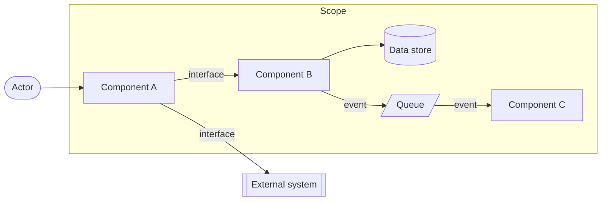
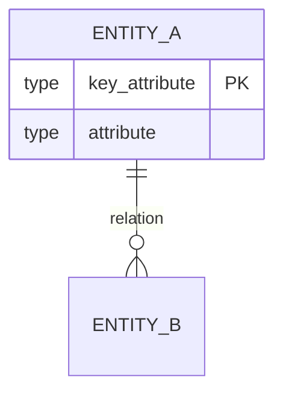
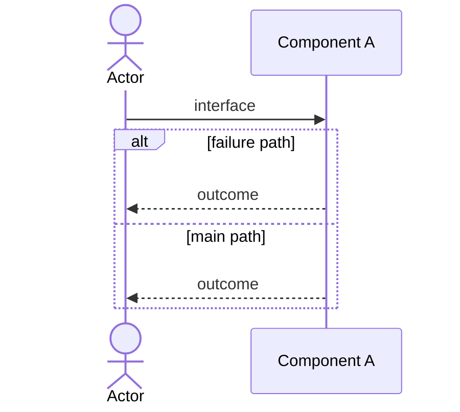

# Technical Specification

The high-level implementation guide for the whole project or one part of it, for those who build it.
It is built on the General Specification and uses its Glossary, and it is drawn rather than written:
each component is mostly mermaid diagrams, and text appears only to clarify what a diagram cannot
show — no narration. The shared sections of `SKILL.md` — *Asking*, *Open questions*, *Shared
checks* — apply throughout.

## Before you start

- **The General Specification** — ask for its path if the Human has not given it, and read it,
  above all the Glossary, the Build sequence, and the MVP. If there is none, say so and offer to
  write it first: a Technical Specification uses its Glossary.
- **The scope** — the whole project, or which part: Backend, Frontend, a single service. A part's
  specification shows the rest of the system only as external nodes at its boundary.
- **Other Technical Specifications** of the project — read those whose scope borders yours: the
  interfaces you share must agree.
- **The codebase**, when the specification describes a system that already exists — a source like
  any other: what it plainly shows is stated, what you read into it is a proposal.

## Components

Interview and write in this order: each component names things the next ones use.

### General Architecture
A component diagram of the scope, drawn as a mermaid `flowchart`: its components — applications,
services, data stores, queues — the actors and external systems around them, and the connections
between them. A large scope gets an overview first, then one diagram per part. Under the diagram, a
table gives each component's responsibility in one line, and its technology once the Human has
chosen one.

A flowchart's shapes and arrows mean nothing by themselves, so every architecture diagram draws
them the same way:
- **Nodes** — a shape for each kind: `([Actor])`; `[Component]` for an application or service;
  `[(Data store)]`; `[/Queue/]` for a queue or topic; `[[External system]]` for a system outside
  the scope, which in a part's specification includes the project's other parts.
- **Arrows** — an arrow points the way the exchange starts: from the caller to what it calls, and
  for an event from the publisher towards its subscribers. A response needs no arrow of its own.
- **Labels** — an arrow is labelled with the Interfaces it carries, named as in the Interfaces
  section, or, when they are endpoints of one API, with the API's name. An arrow from an actor, or
  to a component's own data store, needs no label.
- **Boundary** — a `subgraph` named after what the diagram covers, the scope or one of its parts,
  encloses its components; actors, external systems and any other parts stay outside it.

### Data model
An ER diagram (`erDiagram`) of the entities in scope — Glossary terms — with their key attributes
(the identifiers, and the attributes the interfaces and scenarios rely on, not every field) and
their relations with cardinality. Text only for what the diagram cannot show: an invariant, or which
component owns an entity.

### Interfaces
The contracts between the components, and between the scope and external systems: API endpoints,
events, messages. Each gives its kind, its provider and consumers, and its payload shape — in the
project's own notation when it has one (OpenAPI, protobuf, GraphQL), otherwise as `field: type`
lines using the Data model's names. An endpoint's heading starts with its API's name
(`Order API — POST /orders`), the name the architecture's arrows carry. Contracts are text by
nature; keep each to what its two sides must agree on.

### <Entity> Scenarios
One section per entity — a Glossary term, either an actor (`Customer Scenarios`) or a domain object
(`Order Scenarios`) — with one diagram per scenario. The Human chooses the entities and their
scenarios; you may propose candidates from the MVP and the Build sequence. Pick the diagram that
fits the scenario:
- an interaction between actors and components over time — `sequenceDiagram`, with the components
  of the General Architecture as participants and the Interfaces as messages;
- an entity's lifecycle — `stateDiagram-v2`;
- branching logic — `flowchart`.

Draw the failure paths the Human confirms (`alt` and `opt` blocks in a sequence), not only the main
path.

### Other components
Only when the Human asks for one.

## Mermaid conventions

- Short, stable node ids, with the Glossary or component name as the label — `orders[Order Service]`;
  quote a label that holds punctuation — `api["API (public)"]`.
- One concern per diagram; split a diagram too big to read.
- When mermaid-cli is at hand, run it over the file (`mmdc -i <spec>.md -o <scratch>.md`) to catch
  diagrams that do not parse.

## Checks

- Every domain term is in the General Specification's Glossary. A missing one is defined with the
  Human and, once they approve, added to that Glossary — the only change you make outside the file
  you write.
- The components agree: every participant of a scenario is in the General Architecture, every
  message is an Interface, every entity is in the Data model, every Interface runs along an arrow
  the architecture draws, and every arrow's label names Interfaces or their API.
- The interfaces shared with a bordering Technical Specification match it.

## Template

The diagrams below show syntax only; draw the project's own.

````markdown
# Technical Specification: <project> — <scope>

- **Scope**: <the whole project | the part it covers>
- **General Specification**: `<path>`
- **Updated**: <YYYY-MM-DD>

## General Architecture



| Component | Responsibility | Technology |
| --- | --- | --- |
| <component> | <one line> | <the Human's choice, or empty> |

## Data model



<only what the diagram cannot show — or omit>

## Interfaces

### <interface, e.g. Order API — POST /orders, or order.paid>
- **Kind**: <HTTP endpoint | RPC | event | message>
- **Provider → consumers**: <component> → <component>, <component>
- **Payload**:
  ```
  <field>: <type>
  ```
- **Response**: <shape — or omit for an event>

## <Entity> Scenarios

### <scenario>



<a clarification the diagram needs — or omit>

## Open questions
- **Q1 — <component>**: <the question> — <the options discussed and your recommendation, if any>
<or: None.>
````
