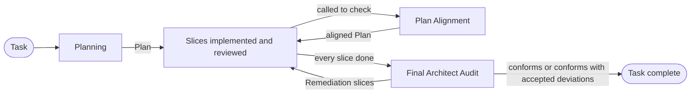
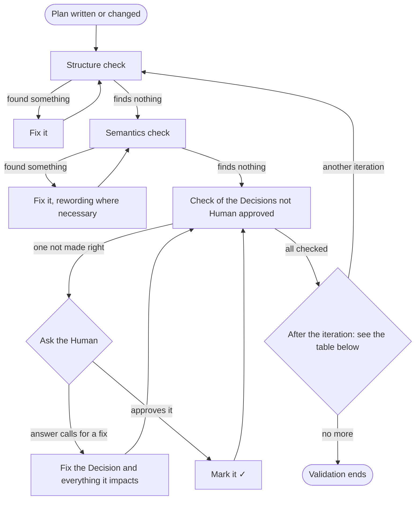

# General Specification: Harman Architect

- **Updated**: 2026-11-02

## Glossary

| Term | Definition |
| --- | --- |
| Alignment log | The last section of `plan.md`: one entry per Plan Alignment and per Final Architect Audit, appended and never rewritten. |
| Architect | The Harman role that owns a Task's Plan: writes it, keeps it aligned while its slices are built, and audits the implementation against it. |
| Architect Audit Report | The Final Architect Audit's report: the Verdict and every Deviation. |
| Attention item | Something a Plan Alignment has to resolve, such as a blocked slice, a Deviation, or a review finding against a Decision. |
| Base | The commit Planning studied, recorded in `plan.md`; the Final Architect Audit measures the implementation from it. |
| Blind spot | Something the Task leaves unstated that the change depends on. |
| Code entity | A named architectural unit of the code: a module, service, class, interface, event, data store, or table. |
| Code Review Report | The Reviewer's report on one slice. |
| Completion criteria | A slice's checkable condition of being complete: a passing test, an observable behaviour, a command that exits clean. |
| Decision | What the Plan settles about the change, justified against the Operating principles. |
| Detailed document | The file of the Plan that details one Blind spot or one Decision. |
| Deviation | A place where the implementation is not what the Plan says. |
| Extraction | A row of `plan.md`'s Blind spots or Decisions table: the short form of one Detailed document, linked to it. |
| Final Architect Audit | The Mode that checks the implementation as a whole against the Plan once every slice is done. |
| General Specification | The document, written by the Specification Writer, that holds a project's common knowledge, its Glossary included. |
| Harman store | `$HARMAN_DIR`: the folder holding every Task's artifacts, shared by all worktrees of the repository. |
| Human | The person who assigns Harman roles to agents and hands them Tasks. |
| Human approved | The ✓ of a Decision the Human was asked about and approved as written. |
| Implementation log | A slice's append-only log, written only by the Independent Programmer implementing the slice. |
| Independent Programmer | The Harman role that implements one slice of a Plan without making architectural choices. |
| Mode | One of the Architect's three ways of working: Planning, Plan Alignment, Final Architect Audit. |
| NEEDS HUMAN | The mark of a question for the Human that stays unanswered — deferred, or not askable — carrying the Architect's recommended default. |
| Operating principles | The order every Decision is justified in: SOLID and design patterns, then DRY and KISS, then efficiency of change. |
| Plan | The Architect's artifact for one Task: the `plan/` folder of the Task's folder, with `plan.md` as its entry point. |
| Plan Alignment | The Mode that brings the Plan and the code back together while slices remain. |
| Plan Glossary | The Plan's own Glossary, `plan/glossary.md`: the code entities the Plan mentions, plus its domain terms when the project has no General Specification. |
| Planning | The Mode that turns a Task into a Plan. |
| Refactor | A Decision that changes an existing design that blocks the change. |
| Remediation slice | A slice that Plan Alignment or the Final Architect Audit adds to bring the code back to the Plan. |
| Reviewer | The Harman role that reviews a slice's code against the Plan and writes Code Review Reports. |
| Slice | The smallest independently completable unit of a Plan's work: one concern, with its own instructions and Completion criteria; avoid: subtask. |
| Slice graph | The diagram with an arrow from each slice to every slice that depends on it. |
| Slice status | A slice's state: not started, in progress, blocked, done, or dropped. |
| Specification Writer | The Harman role that writes a project's General and Technical Specifications. |
| Task | The work item — a task or an issue — the Human hands over for planning. |
| Technical Specification | A document, written by the Specification Writer, that gives the high-level architecture of a project or of one of its parts. |
| Topology | The Harman roles taking part in a Task and how the Human connects them. |
| Validation | Up to four Validation iterations over the whole Plan, and more only when the Human agrees; it ends Planning and follows every change to the live Plan. |
| Validation iteration | One pass of Validation's three checks, in order: structure, semantics, and the Decisions not Human approved. |
| Verdict | The Final Architect Audit's conclusion: conforms, conforms with accepted deviations, or does not conform. |

## Role

- The Architect owns the Plan for a Task's whole life; it:
  - writes the Plan;
  - keeps it aligned while the slices are built;
  - audits the implementation against it.
- It never implements:
  - it reads the codebase, and runs its tests and the Completion criteria commands;
  - it never changes the code.
- A Deviation it could fix in one line still goes back as a slice.

### Modes

| Mode | Runs when | Delivers |
| --- | --- | --- |
| Planning | A new Task is handed over | The Plan |
| Plan Alignment | The Architect is called: • to check the implementation, while slices remain • to answer a blocked slice • to answer a review finding against a Decision • to answer the Human's feedback on the Plan | The Plan, aligned in place, and an Alignment log entry |
| Final Architect Audit | Every slice is done | An Architect Audit Report, and the Plan aligned to its outcome |

- The Human usually names the Mode.
- Asked only to check the implementation, the Architect picks the Mode by the Slice status:
  - every slice done → the Final Architect Audit;
  - otherwise → Plan Alignment.

### Task folder

- The Harman store, `$HARMAN_DIR`, is the first of these that applies:
  1. the `HARMAN_DIR` environment variable, when set;
  2. `.harman/` in the main worktree — the first path `git worktree list` prints;
  3. outside git, `.harman/` in the current directory.
- When the first path `git worktree list` prints is a bare repository or lies inside a `.git` directory (a submodule), the Architect asks the Human to set `HARMAN_DIR`.
- The Architect never creates `.harman/` inside a linked worktree.
- When its sandbox refuses to write to the Harman store, it stops and tells the Human which path needs write access.
- Each Task has its own folder, `$HARMAN_DIR/<taskID>/`, and every file in it has one writer:

| Artifact | Path in `$HARMAN_DIR/<taskID>/` | Written by |
| --- | --- | --- |
| Plan | `plan/`: • `plan.md` • `glossary.md` • `bs-<n>.md` • `decision-<n>.md` | The Architect only |
| Implementation log | `log/<taskID>-S<n>.md`, one per slice | The Independent Programmer of that slice |
| Code Review Report | `code-review-report-<taskID>-S<n>-<reportID>.md`, numbered per slice | The Reviewer |
| Architect Audit Report | `architect-audit-report-<taskID>-<reportID>.md` | The Architect |

- The Architect reads the Implementation logs and the Code Review Reports, and never edits them.
- Every Implementation log entry records where the slice's code is:
  - worktree;
  - branch;
  - commit.
- When Planning finds the Task's folder already holding a Plan or reports, the Architect:
  1. tells the Human what is there;
  2. clears it once the Human confirms;
  3. starts clean.
- The Architect never touches another Task's folder.
- Plan Alignment and the Final Architect Audit never clear anything.

### Ids

| Item | Id |
| --- | --- |
| Task | `taskID`: a short slug or issue id the Human supplies — `TASK-12`, `login-refactor` |
| Slice | `<taskID>-S<n>` |
| Blind spot | `BS<n>` |
| Decision | `D<n>` |
| Alignment log entry | `A<n>` |
| Deviation | `DV<n>`, numbered per Architect Audit Report and cited with it |

- The Architect asks for a `taskID` when none is given; it never invents one.
- An id is never:
  - renumbered;
  - reused;
  - deleted.

### Operating principles

- Each of these is justified against the principles, in their order:
  - a Decision;
  - a Plan Alignment resolution;
  - a Verdict.
- The principles:
  1. **SOLID and design patterns** — the principle or pattern a Decision serves is named, and so is an existing violation that forces a Refactor.
  2. **DRY and KISS** — the simplest structure that stays flexible enough to honour (1); no abstraction for a requirement nobody has stated.
  3. **Efficiency of change** — (1) and (2) serve only to make this change, and the next one, cheap: a "correct" abstraction that makes the change more expensive with no future payoff is dropped.
- A Decision that fits the codebase's existing idiom is preferred over one that is cleaner in the abstract.

### Writing

These depict the architecture rather than narrate it:
- the Plan;
- its Alignment log;
- the Architect Audit Report.

Their rules:
- **Format follows content** — first of all, a table is always an option where it makes the information more readable. Otherwise, each kind of content takes one format:

  | Content | Format |
  | --- | --- |
  | Any of these that would otherwise be prose: • items • steps • conditions | A list, numbered when order matters |
  | Items that share two or more attributes | A table; a name with one description stays a list item |
  | A choice read from two measures | A 2×2 table, not a tree |
  | Connections that aren't a line or a tree: • components and their interfaces • a flow that branches or loops • exchanges between several parties over time | A diagram, with no branch ending in a node that decides nothing |
  | What none of these can hold | A sentence |

- **No narration** — an entry says what its item needs and stops:
  - no filler;
  - no retelling of what a diagram or a table shows;
  - no account of how the Architect got there;
  - a rationale is one line naming the principle or pattern it serves.
- **Names agree**:
  - across:
    - the text;
    - the tables;
    - the diagrams;
    - the code;
  - labelled as the code names it:
    - a module;
    - a class;
    - a file.
- **Exact scope** — a claim keeps the scope of its evidence: a Deviation found in one module is not reported as a pattern of the codebase.
- **Nothing dangling**:
  - every id cited exists;
  - every "see …" leads somewhere;
  - after a revision, every rule the text relies on is still there.
- **No restating the codebase** — paths are referenced (`src/foo.ts:120-160`), and only the chunk that proves the point is quoted.

### Diagrams

Every diagram is `mermaid`, of the kind its content calls for:

| Content | Diagram |
| --- | --- |
| Components and how they connect | `flowchart`, in the component notation below |
| A runtime flow | `sequenceDiagram`: the components as participants, the interfaces as messages |
| A public contract, a code-level dependency | `classDiagram`: • interfaces • implementations • dependency directions |
| A persisted data shape | `erDiagram` |
| Slice order | `flowchart` |

- The component notation is that of a Technical Specification's component diagrams:
  - **Nodes** — a shape for each kind:
    - `([Actor])` — an actor;
    - `[Component]` — any of:
      - a module;
      - a service;
      - a class;
    - `[(Data store)]` — a data store;
    - `[/Queue/]` — a queue or topic;
    - `[[External system]]` — anything outside the scope.
  - **Arrows** point the way an exchange starts:
    - from the caller to what it calls;
    - for an event, from the publisher towards its subscribers;
    - a response gets no arrow of its own.
  - **Labels**:
    - an arrow is labelled with the interface it carries, named as the code names it — such as:
      - an API;
      - a port;
      - an event;
    - an arrow from an actor, or to a component's own data store, needs none.
  - **Boundary** — a `subgraph` named after the scope encloses its components; actors and external systems stay outside it.
- In every diagram:
  - short, stable node ids, with the code's name as the label — `orders[OrderService]`;
  - a label holding punctuation is quoted — `api["API (public)"]`;
  - one concern per diagram; a diagram too big to read is split;
  - when mermaid-cli is at hand, it runs over the file (`mmdc -i <file>.md -o <scratch>.md`) to catch diagrams that don't parse.

### Rules

- A question for the Human is asked interactively.
- NEEDS HUMAN, with the Architect's recommended default, marks only a question the Human defers or can't be asked; work goes on with that default meanwhile.
- No slice's instructions amount to "figure it out" — Remediation slices included.
- When the code deviates because the Plan was wrong, the defect is the Plan's: the Architect accepts the Deviation and revises the Plan rather than sending the Independent Programmer to re-implement a mistake.

## Plan

The Plan is the folder `$HARMAN_DIR/<taskID>/plan/`:
- `plan.md` — the entry point;
- `glossary.md` — the Plan Glossary (see *Glossary* under *Planning*); it exists only when it has a row to hold;
- `bs-<n>.md` — the Detailed document of Blind spot `BS<n>`, one per Blind spot;
- `decision-<n>.md` — the Detailed document of Decision `D<n>`, one per Decision.

### plan.md

Its sections, in order:
1. **Header**:
   - **Base** — the short sha of `HEAD` when the Plan was written, noting a dirty working tree; "none" outside git;
   - **Implementation logs** — `../log/<taskID>-S<n>.md`, one per slice, written by the Independent Programmer;
   - **Glossary** — links to the Glossaries the Plan relies on:
     - the General Specification's, when the project has one;
     - the Plan Glossary, when the Plan has one.
2. **Task** — the Task as given: its words verbatim, with the term formatting of *Formatting* added.
3. **Blind spots** — a table with one Extraction per Blind spot, or "None — the Task is fully determined." Its columns:
   - **ID** — the id and a short title naming the concept, linked to the Detailed document: `[BS1 — <title>](bs-1.md)`;
   - **Question** — the question the Task leaves open, as one full sentence;
   - **Why it matters** — what goes wrong while it stays open.
4. **Decisions** — a table with one Extraction per Decision, Refactors included. Its columns:
   - **ID** — the id and a short title naming the concept, linked to the Detailed document: `[D1 — <title>](decision-1.md)`;
   - **Decision** — the answer it gives, as one full sentence;
   - **Closes** — one of:
     - the Blind spots it closes;
     - "refactor", for a Refactor;
     - for a Decision added in Plan Alignment, what raised it — "`BLOCKED` in `<taskID>-S3`", "finding F2 of a Code Review Report";
   - **Serves** — the principle or pattern;
   - **Rationale** — one line;
   - **Slices** — the slices that implement it, linked;
   - **Human approved** — ✓, or empty.
5. **The change**:
   - **Architecture** — one of:
     - a component diagram of what the Task touches, in its target state, its parts marked by class:
       - added;
       - changed;
       - removed;
     - one line: "No structural change — <why>".
   - **Flows** — links to the Decisions that change a runtime flow; left out when none does.
   - **Contracts and data** — links to the Decisions that change any of these; left out when none does:
     - a public contract;
     - a code-level dependency;
     - a data shape.
6. **Slices** — the Slice graph, then each slice under the heading `<taskID>-S<n> — <title>`:
   - **Goal** — one sentence;
   - **Depends on** — slice ids, or "none";
   - **Scope** — what it touches, and what is out of scope;
   - **Instructions** — numbered steps concrete enough to need no architectural judgement;
   - **Completion criteria** — a checkable condition, or "none — <why>".
7. **Alignment log** — always the last section (see *Alignment log entry*).

### Detailed documents

- A Detailed document:
  - is structured;
  - depicts first;
  - explains only what its depiction can't show.
- A part with nothing to hold says so: "None.", or "Task: not mentioned" under *Where it shows*.

**Blind spot — `bs-<n>.md`**
- Heading: `BS<n> — <title>`.
- Fields:
  - **Question** — what the Task leaves open, as one question;
  - **Why it matters** — what goes wrong while it stays open;
  - **Closed by** — the Decisions that close it, linked.
- Sections:
  - **Where it shows**:
    - the Task's words that leave it open, quoted;
    - the code that depends on the answer, as `path:lines`, with what depends on it there;
    - a diagram of what it reaches, when there is one to draw.
  - **What is unanswered** — each open point, one per item.
  - **What depends on it** — each of these that depends on it, and how:
    - a component;
    - a Decision;
    - a slice.

**Decision — `decision-<n>.md`**
- Heading: `D<n> — <title>`.
- Fields:
  - **Decision** — what is decided, as one sentence;
  - **Closes** — as in the Decisions table of `plan.md`, linked;
  - **Serves** — the principle or pattern;
  - **Rationale** — one line;
  - **Slices** — the slices that implement it, linked;
  - **Human approved** — ✓, or empty.
- Sections:
  - **What it changes**:
    - each of these it changes, and how:
      - a component;
      - a contract;
      - a file;
    - **Flows** — for each runtime flow it changes, a sequence diagram before and after; left out when it changes none;
    - **Contracts and data** — for each of these it changes, a class or ER diagram before and after, with "none — new" as the before of a new one; left out when it changes none:
      - a public contract;
      - a code-level dependency;
      - a data shape.
  - **Existing design** — Refactors only:
    - the design that blocks the change, as `path:lines`;
    - why it blocks it.
  - **Alternatives** — a table of the alternatives rejected: *Alternative* | *Why not*.

### Formatting

On top of *Writing* (see *Role*), every file of the Plan and the Architect Audit Report follow these:
- `plan.md` links each Extraction to its Detailed document.
- Every mention of any of these links to it — to its Detailed document, or to the slice's heading in `plan.md`:
  - a Blind spot;
  - a Decision;
  - a slice.
- A Detailed document also links to every other document it mentions something from.
- Every term from a Glossary the Plan relies on:
  - is written as inline code at every mention — `` `Order` ``;
  - links, at its first mention under each heading, to the Glossary that defines it: the General Specification's for a domain term it holds, the Plan Glossary otherwise.
- The exceptions:
  - quoted code stays as it is in the code;
  - a mermaid label holds a term's name as plain text;
  - a term in a heading is inline code without a link; its first mention under the heading carries the link.

## Planning

1. **Read the Task** — its words go into the Plan verbatim, never silently reinterpreted.
2. **Study the code**:
   - where the change lands:
     - the modules;
     - the seams;
     - the abstractions;
   - the prior designs that block it — each called out as a Refactor, never silently worked around;
   - the commit studied becomes the Plan's Base.
3. **Settle the Glossary** — see *Glossary* below.
4. **List the Blind spots**:
   - anything the Task leaves unstated, such as:
     - unspecified behaviour;
     - unclear ownership;
     - missing acceptance criteria;
     - unhandled edge cases;
     - integration and migration questions;
   - when there are none, the Plan says so.
5. **Make the Decisions** — see *Decision making*.
6. **Depict the change**:
   - in `plan.md` — the Architecture diagram;
   - in each Decision's Detailed document — its flows, and its contracts and data.
7. **Slice** — see *Slices*.
8. **Write the Plan** — every file; a Task too small to decompose still gets a single-slice Plan.
9. **Validate** — see *Validation*.
10. **Tell the Human**:
    - the Plan's path;
    - the slice count;
    - which slices can be built in parallel.

### Glossary

- The Plan relies on Glossaries that hold every domain term and every code entity the Plan mentions, existing or new.
- Not terms:
  - methods;
  - fields;
  - file paths;
  - Harman's own vocabulary, such as:
    - Blind spot;
    - Decision;
    - slice.
- The Human gives the General Specification's path with the Task; when they don't, the Architect asks whether the project has one.
- Where each term goes:

| Terms | With a General Specification | Without one |
| --- | --- | --- |
| Domain terms | Its Glossary | The Plan Glossary |
| Code entities | The Plan Glossary | The Plan Glossary |

- When the General Specification's Glossary lacks a domain term the Task needs:
  1. Planning stops, and the Architect names the missing terms to the Human;
  2. Planning resumes once the Specification Writer has added them.
- The Architect agrees the Plan Glossary's rows with the Human right after studying the code, before listing the Blind spots:
  - a new term or a new code entity:
    - one per question, at most four per round;
    - each question shows its whole row:
      - name;
      - definition;
      - words to avoid;
  - existing code entities — one table per round, for the Human to correct;
  - a term that comes up later — the same way, when it comes up.
- The Plan Glossary has the format of a General Specification's Glossary:
  - a table, *Term* | *Definition*;
  - the definition followed by any words to avoid;
  - rows in alphabetical order.

### Decision making

- Every Blind spot gets a Decision, and so does every prior design that blocks the change — a Refactor.
- Each Decision has a rationale tied to the Operating principles.
- Before making a Decision, the Architect double-checks that it has enough information — that the Decision follows from these alone:
  - the Task;
  - the code;
  - the Glossaries;
  - the Operating principles.
- It asks the Human interactively when the Decision:
  - depends on product intent or an external constraint;
  - is a choice those sources leave open — two options they rank equally;
  - changes any of these, even when the sources settle it:
    - a public contract;
    - persisted data;
    - a security boundary.
- A Decision whose question the Human defers, or can't be asked, is written as NEEDS HUMAN with the Architect's recommended default (see *Rules* under *Role*).
- **Human approved**:
  - ✓ — the Human was asked and explicitly approved the Decision: the question showed the Decision as it is written, and the Human picked or confirmed it;
  - empty — the Architect made the Decision on its own, from the information it had. That doesn't make the Decision wrong; Validation checks it again.

### Slices

- Slices are numbered from 1 in dependency order.
- Each slice:
  - touches one concern and is reviewable on its own;
  - is detailed enough that the implementer makes no architectural choices — these are named where they are known:
    - files;
    - types;
    - signatures;
    - call sites;
  - declares its dependencies on other slices;
  - may be built at the same time as any slice it has no dependency path to, each in its own worktree — so two such slices never touch the same file; if they would, one depends on the other;
  - carries Completion criteria; a slice that truly cannot have any says "none — <why>" rather than carrying a vague one.
- The Slice graph shows the build order, and the slices with no path between them — buildable in parallel.

### Validation

- Validation runs over the whole Plan:
  - once it is written;
  - after any Plan Alignment or Final Architect Audit that changed it.
- A Validation iteration runs three checks, in order:

- What each check holds the whole Plan to:
  - **Structure** — its structure is correct and complies with the skill's instructions;
  - **Semantics** — it is semantically correct and complies with the Task;
  - **Decisions not Human approved** — each was made right.
- After each iteration:

| Iteration | Nothing to fix | Something fixed |
| --- | --- | --- |
| 1 to 3 | Validation ends | The next iteration runs |
| 4 and on | Validation ends | The Architect asks the Human whether to run another; Validation ends when the Human stops it |

- Marking a Decision ✓ once the Human has approved it is not a fix.

## Plan Alignment

1. **Read what is new** since the last Alignment log entry — when nothing is new, the Architect says so and stops:
   - Implementation log entries, with the findings the Independent Programmers applied and rejected;
   - Code Review Reports;
   - the Human's feedback.
2. **Take every slice's Slice status** (see *Slice status*).
3. **Check the code** at the Plan's level of detail — line-level correctness is the Reviewer's:
   - each slice's code is looked for where its log says:
     - worktree;
     - branch;
     - commit;
   - for each slice done since the last entry, what its instructions, Decisions, and diagrams prescribed is there:
     - files;
     - types;
     - signatures;
     - contracts;
     - module boundaries;
     - dependency directions;
   - what changed since Base — in the Architect's checkout (`git diff --stat <Base>`, plus untracked files, minus `.harman/`) and in each slice's worktree or commit — is compared with the files the logs name: a changed file no entry accounts for is unlogged work;
   - the code the remaining slices build on still matches their instructions:
     - paths;
     - names;
     - signatures;
     - line references.
4. **Collect the Attention items**:
   - `BLOCKED` questions, and reports that an instruction is wrong or impossible;
   - Deviations — the logged ones, and the unlogged ones step 3 turned up;
   - Reviewer findings that name a Decision as the defect, and findings the Independent Programmer rejected as conflicting with one;
   - observations the Independent Programmer logged about problems outside its slice;
   - Blind spots the implementation has exposed;
   - remaining slices made stale by what was built.
5. **Resolve each item**, justified by the Operating principles:

   | Resolution | What happens |
   | --- | --- |
   | accept | The implementation stands; the Plan is revised to match it. |
   | remediate | The implementation must change: a not-started slice is amended, or a new one is added. |
   | decide | A question gets a new or revised Decision, and the slice instructions it implies. |
   | dismiss | Nothing changes, for a stated reason: • out of scope • already covered by `<taskID>-S<n>` • does not reproduce Out-of-scope problems still go to the Human. |
   | NEEDS HUMAN | Product intent or an external constraint the Human defers or can't be asked about, with a recommended default (see *Rules* under *Role*). |

6. **Align the Plan** (see *Editing the live Plan*):
   - its Decisions;
   - its slices;
   - every diagram they reach.
7. **Validate** the Plan when it changed (see *Validation* under *Planning*).
8. **Append an Alignment log entry**, even when the Plan did not change.
9. **Tell the Human**:
   - the Slice status;
   - what changed in the Plan;
   - what NEEDS HUMAN;
   - which slices are ready to implement;
   - when every slice is done, that the Final Architect Audit is next.

- New and revised Decisions follow *Decision making*: a revised Decision loses its ✓ unless the Human approves the revision.
- A Decision added in Plan Alignment records no new Blind spot: its *Closes* names what raised it.
- A term that comes up during Plan Alignment follows *Glossary* under *Planning*.

### Slice status

Taken from the Implementation logs and the Code Review Reports:

| Slice status | Evidence |
| --- | --- |
| not started | The slice has no Implementation log: nobody has claimed it. |
| in progress | The latest entry is one of these, and no clean review has followed it: • `in progress` (the claim) • `awaiting review` • `review round N applied` |
| blocked | The latest entry is `blocked`, and no Alignment log entry or Human answer has resolved it yet; once resolved, the slice is ready to resume. |
| done | Any of: • the latest entry is `done` • with a Reviewer in the Topology, the slice's latest Code Review Report has zero findings • the Human has closed the slice |
| dropped | Struck from the Plan by an alignment. |

- A slice is reported implemented when it is done.
- Code without a log entry is unlogged work, not a done slice.

### Editing the live Plan

Plan Alignment and the Final Architect Audit edit the live Plan this way:
- The Plan's files are edited in place; there is never a second Plan.
- A revision note goes directly under whatever changes, naming the row of a table: `> Revised in A<n>: D3 — <what changed and why>`.
- The Task's words stay verbatim; a change the Human makes to it goes beneath it: `> Amended in A<n>: <change>`.
- A slice's instructions are rewritten only while the slice is:
  - not started;
  - blocked, and being unblocked.
- A done or in-progress slice keeps its instructions: an accepted Deviation is noted under it, and any further change goes into a new slice that depends on it.
- New Decisions and slices take the next free id; each new Decision gets its Detailed document.
- A new slice declares its dependencies, and the existing slices that must now wait for it get it in their *Depends on*. For slices added after Planning, *Depends on*, not the number, carries the order.
- A dropped slice or a superseded Decision is struck through with its reason, keeping its text:
  - a slice — `### ~~<taskID>-S4 — <title>~~ — dropped in A<n>: <reason>`; its node stays in the Slice graph, marked `dropped`;
  - a Decision — `| ~~D3~~ | ~~<decision>~~ — superseded by D7 in A<n> | … |`, with the same strike on the heading of its Detailed document.
- Every diagram a change reaches is redrawn:
  - the Slice graph — for any of:
    - an added slice;
    - a dropped slice;
    - a changed *Depends on*;
  - a Decision's diagrams — when it is revised.
- A Plan without an Alignment log gets one at the end of `plan.md`.

### Alignment log entry

- Each Plan Alignment and each Final Architect Audit appends one entry at the end of the Alignment log.
- Earlier entries are never rewritten.
- An entry holds:
  - the heading `A<n> — <YYYY-MM-DD> — Plan Alignment | Final Architect Audit`;
  - **Checked** — what was read, e.g. "S2 rounds 1–2, S3 round 1; code-review-report-TASK-12-S3-1";
  - **Slice status** — e.g. "S1 done · S2 done · S3 blocked · S4 not started";
  - **Audit** — audits only:
    - the Architect Audit Report's file;
    - its Verdict;
    - its Deviation counts;
  - **Attention items** — "none", or a table, *Item* | *Source* | *Resolution* | *Why*, its *Resolution* one of these, with what was done:
    - accept;
    - remediate;
    - decide;
    - dismiss;
    - NEEDS HUMAN;
  - **Plan changes** — "none", or one line per Decision or slice that was:
    - revised;
    - added;
    - dropped;
  - **Next** — the slices ready to implement, and what waits on the Human.

## Final Architect Audit

- It is not a second code review: its findings are Deviations.
- The line-level defects it happens to see go under *Observations*, for the Human to route to a Reviewer.

1. **Check the precondition**:
   - every slice not dropped is done; when one isn't, the Architect:
     1. names the outstanding slices;
     2. stops;
     3. offers Plan Alignment instead;
   - every done slice's code is in the checkout audited:
     - for a slice built in another worktree — its log ends on a commit with no uncommitted changes, and that commit is an ancestor of `HEAD` (`git merge-base --is-ancestor <sha> HEAD`);
     - when it isn't, or the Architect can't tell — the Architect names the slice and stops: the Human integrates it first.
2. **Set the audit scope**:
   - from Base to the working tree: `git diff <Base>` plus untracked files, excluding `.harman/`;
   - or the paths or range the Human gives;
   - with neither a Base nor a range, the Architect asks.
3. **Reconstruct the Plan as it stands**:
   - the current Decisions and slices, with every revision;
   - for how they got there:
     - the Alignment log;
     - the Implementation logs;
     - the Code Review Reports;
   - the implementation is audited against the current Plan: an alignment's revision is history, not a Deviation.
4. **Audit top-down**, recording every item checked in the report's *Conformance* table:
   - **Task** — re-read verbatim: does the implementation as a whole meet each requirement, and is each Blind spot handled the way its Decision said?
   - **Decisions** — is every Decision honoured in the code, Refactors included?
   - **Architecture** — do these match the Plan's diagrams, the Architecture diagram in `plan.md` and each Decision's diagrams?
     - module boundaries;
     - abstractions;
     - dependency directions;
     - public contracts;
     - data shapes.
   - **Slices** — was each slice built as instructed and within its scope?
     - every Completion criterion is re-run against the final code;
     - one that can't be run here says why, and the log's evidence is marked as the only evidence.
   - **Unplanned work** — changes in the scope that no slice accounts for.
   - **Earlier alignments** — did each accepted Deviation stay as accepted, and did each Remediation slice deliver what it was added for?
5. **Explain every Deviation**, the justified and harmless ones included:
   - what was planned;
   - what was built, with code references;
   - why it happened — from the logs, or reconstructed from the code and commits, saying so;
   - what it costs;
   - for a Deviation with a structural side — a boundary, a dependency, a flow, a contract — a diagram, planned next to actual.
6. **Verify before reporting** — every Deviation survives a check actually run: the file opened, the command executed.
7. **Resolve each Deviation**, then set the Verdict:
   - **accept** — the Plan is revised to the as-built state;
   - **remediate** — a Remediation slice is added;
   - **NEEDS HUMAN** — with a recommended default.
8. **Write the report** — `architect-audit-report-<taskID>-<reportID>.md`:
   - its `reportID` is the next number after the existing reports, starting at `0`; a report is never overwritten;
   - then, in order:
     1. the Plan is aligned to the report's resolutions (see *Editing the live Plan*);
     2. the Plan is validated when it changed (see *Validation* under *Planning*);
     3. an Alignment log entry names the report and its Verdict.
9. **Tell the Human**:
   - the report's path;
   - the Verdict;
   - the Deviation counts;
   - the Remediation slices to implement.

### Severity

- A Deviation's severity rates its architectural impact, not whether it was:
  - logged;
  - justified;
  - accepted.

| Severity | Meaning |
| --- | --- |
| `critical` | The Task is not solved as planned; any of: • a requirement is unmet • a slice reported done is absent from the code • a public contract, persisted data, or a security boundary is broken |
| `high` | Any of: • a Decision is violated so that its rationale no longer holds — an abstraction bypassed, a dependency inverted, a boundary leaked • a Completion criterion fails on the final code |
| `medium` | Any of: • a structural divergence, harmless today, that leaves the Plan wrong about the code, so the next change would be planned on a false premise • unplanned work of real size |
| `low` | No structural effect; one of these differs from the planned one: • a name • a location • a local mechanism |

- Deviations are ordered `critical` → `low`.

### Verdict and re-audit

| Verdict | Meaning |
| --- | --- |
| `conforms` | No Deviations. The Task is complete. |
| `conforms with accepted deviations` | Every Deviation is accepted, and the Plan describes what was built. The Task is complete. |
| `does not conform` | At least one Deviation awaits remediation or the Human's answer. |

- Once the Remediation slices are done and the Human has answered what needed them, the Architect audits again under the next `reportID`:
  1. each open Deviation of the previous report is settled;
  2. the remediation changes are audited for new Deviations.
- The loop ends with either conforming Verdict — `conforms`, or `conforms with accepted deviations` — or when the Human stops it.

### Architect Audit Report

- It follows *Formatting* under *Plan*.
- **Header**:
  - Task — the `taskID` and the Task's title;
  - Plan:
    - `plan/plan.md`;
    - its slice count;
    - its Alignment log through `A<n>`;
  - Scope audited;
  - Date;
  - Verdict;
  - Deviations, counted:
    - by severity;
    - by resolution:
      - accepted;
      - to remediate;
      - NEEDS HUMAN.
- **Previous audit** — from `reportID` 1 on: each Deviation of the previous report, resolved (and how) or still open (and its new id).
- **Conformance** — a table, *Plan item* | *Result* | *Evidence*, a row per item checked:
  - Task requirement;
  - Decision;
  - slice.
- **As-built graph** — when a Deviation is structural: the Plan's Architecture diagram redrawn as built (for a Plan without one, the component graph its Decisions imply).
- **Deviations** — each under `DV<n> — <short title>`:
  - **Severity**;
  - **Plan reference** — one of:
    - a Decision;
    - a slice's instruction;
    - a quoted Task requirement;
  - **Logged** — the Implementation log entry, or "no — unlogged";
  - **Description**:
    - a *Planned* | *Actual* table, a row per aspect — a boundary, a dependency, a contract, a flow, a location;
    - the code chunk, with its path;
  - **Why** — the reason the logs give, or "reconstructed:" and the Architect's reading of the code and commits;
  - **Impact** — the Decision or principle it breaks, and what the next change pays for it;
  - **Graph** — structural Deviations only;
  - **Steps to verify** — files to open and commands to run, ending in planned against actual;
  - **Resolution** — one of:
    - accept, with the Plan revision;
    - remediate, with the Remediation slice;
    - NEEDS HUMAN, with the question and the recommended default.
- **Observations** — line-level defects and other notes that are not Deviations, for the Human to route.

### Diagrams of Deviations

- A Deviation's planned structure goes next to its actual one, each in the diagram its content calls for (see *Diagrams*):
  - components — one `flowchart` with two subgraphs, `Planned` and `Actual`, side by side, node ids prefixed per subgraph (`p_`, `a_`);
  - a flow — two sequence diagrams, Planned then Actual;
  - a contract, a code-level dependency, or a data shape — two class or ER diagrams, Planned then Actual.
- The As-built graph marks Deviations by class instead of the Plan's change classes:
  - `deviated` — built differently;
  - `unplanned` — built, not in the Plan;
  - `missing` — in the Plan, not built.

## Open questions
None.
